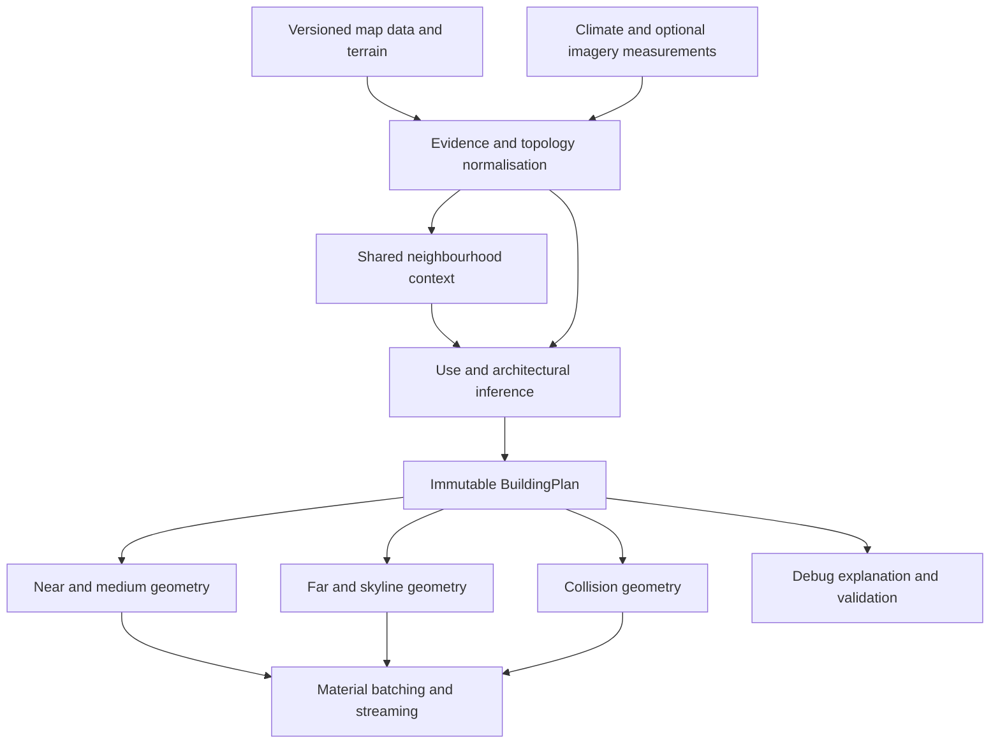

# Procedural buildings v2

Current regional detail authoring: [25 architectural modifiers and spawn rates](REGIONAL_ARCHITECTURAL_MODIFIERS.md).

Current roof authoring: [roof proportions, attic windows and dormers](ROOF_PROPORTIONS_AND_ATTICS.md). Shared inference limits apply across all 64 regional profiles and five contemporary families; tall eligible roofs receive fitted attic details. Historical checkpoint statements below retain their original scope.

Design proposal for `dev`, based on commit `55ddc418`. This document specifies the target architecture. The compiler-plan/evidence foundation, experimental courtyard/multipart geometry and complete near-building chunk transport are implemented; [implementation status](BUILDINGS_V2_IMPLEMENTATION.md) distinguishes these from the remaining proposed modules, schemas and budgets below.

## Intended result

Generate buildings that make sense as individual structures and as part of a street. A building's use determines its entrances, floor layout and service areas; its structure determines its massing and roof; local evidence and physical environment influence its architectural vocabulary and materials. Those decisions produce one persistent plan from which every visual detail level and collision mesh is derived.

The result should distinguish a house, apartment block, shop, office and warehouse even before textures are applied. Buildings on the same street should feel related without becoming copies. Missing data should reduce specificity, rather than cause a confident but arbitrary architectural choice.

This is an exterior generation system for driving and flying. The first release includes mapped building footprints, mixed use, complex roofs, courtyards, façades, foundations, material variation and collision. Full interiors, inferred parcel ownership, recognisable reconstructions of unmapped landmarks, and inventing buildings where no footprint exists are separate projects. Existing specialised generators remain responsible for ships, bridge structures, toll booths and gas stations.

### Quality hierarchy

Resolve quality in this order: observed position and dimensions; plausible use and construction; coherent architectural composition; correct surface response and lighting; then decorative detail. More polygons must not compensate for the wrong height, and a convincing material must not hide an incorrect building/road overlap.

Keep three separate assessments in reports: **accuracy** against available observations, **believability** of inferred construction and use, and **presentation quality** of the rendered result. A sparse-data building can have excellent presentation while remaining an uncertain reconstruction. Record evidence coverage alongside each assessment.

Each feature proposal must identify its evidence requirement, geometric attachments, material/lighting needs, LOD fallback and validation case. Introduce features as coherent assemblies—a balcony includes a supported slab, railing, access opening and façade connection—rather than independently scattering decorative objects.

## Existing pipeline and replacement boundary

| Current component | What exists | Proposed treatment |
| --- | --- | --- |
| `server/overture.py`, `server/mapdata.py` | Footprints, building parts, class, height, floors, roof and façade attributes; roads, infrastructure, land use and optional places | Retain acquisition and provenance; preserve more of that evidence through planning |
| `server/mapgeom.py` | Multipolygons and interior rings in columnar geometry | Preserve this topology throughout the new generator |
| `server/buildings.py:region_style`, `plan` | Broad latitude/longitude boxes; footprint/class heuristics; one `Spec` | Replace with evidence resolution, contextual inference and a structured building plan |
| `server/buildings.py:tile_buildings` | Ownership, deduplication, part handling, terrain sampling and infrastructure exceptions | Extract and retain these responsibilities behind an adapter; do not rewrite them all at once |
| `server/buildings.py:build_parts`, `collision_mesh` | Batched visual meshes, a lite representation and lean physics mesh | Compile all three from the same semantic plan |
| `server/buildings.py:far_items`, `sky_items` | Separate entry points for distant buildings | Read the same plans as the near builder, with no independent use/style inference |
| `server/cdae.py`, `server/buildings.py:write` | Primary-mesh normals/secondary UV support; building adapter and embedded LOD path omit those attributes | Carry and validate the complete shading payload across every representation |
| `server/roads.py:write_tile`, mod `roads.lua` | `bld` through `bld4`, `bldcol`, far/skyline replacement and collision scheduling | Preserve the scheduler; introduce negotiated chunk lists before dense v2 rollout |
| Mod `nightlights.lua`, `sky.lua`, `weather.lua` | Shared building emission, nearby street lights and world lighting/weather | Extend bounded lighting cohorts and fixture pools through these existing owners |
| `server/revisit.py` | Persistent generated-content cache and source/native fingerprint | Extend cache identity to include catalogues, context manifests and nested generator modules |

Concrete limitations visible in the current code:

- `tile_buildings` begins from `parts[0][0]`: the first polygon's exterior. The underlying data can represent holes and additional polygons, but the ordinary building path does not carry them into its `Spec`.
- `overture.py` reads roof direction/orientation and height source, but the ordinary attribute selection in `tile_buildings` does not forward them to `plan`.
- Large unclassified or commercial footprints can become industrial based mainly on area. Ground-floor use and upper-floor use are not represented independently.
- Existing façade sheets improve batching, but repeated floor bands constrain layout and material variety.
- `collision_mesh` substitutes an oriented rectangle for pitched-roof footprints. The replacement must preserve concave building boundaries and openings in physics.
- `roads.write_tile` takes only the first `BLD_PARTS_MAX` meshes, currently four. V2 must not rely on truncation when richer geometry exceeds that capacity.

Retain the useful exceptions already tested: open parking decks, tunnel portals, bridge passages, terrain foundations, underground suppression, false building detections on roads/water, mapped parts and toll islands. Their behaviour is part of compatibility, not incidental detail.

The [roadmap](ROADMAP.md) requires globally applicable rules and deterministic generation. Geography here means measured geographic context and locally observed building patterns, not new coordinate boxes or a country-to-style switch. Named places below are validation cases, never branches in generation code.

## Architecture



The planner is a pure, CPU-based function. It neither downloads data nor queries an AI service. Acquisition happens through existing map-data scheduling before planning. The initial classifier is an inspectable weighted rules model; a small trained model can later replace its scoring function without changing the plan or renderer contracts.

### Proposed modules

| Module | Responsibility |
| --- | --- |
| `server/buildgen/evidence.py` | Source adapters, units, conflicts, topology, stable identity |
| `server/buildgen/context.py` | Spatial indices, adjacency, street frontage and neighbourhood summaries |
| `server/buildgen/inference.py` | Use scores, morphology, height estimates, architectural compatibility |
| `server/buildgen/plan.py` | Immutable schema, constraints, deterministic choices and explanation records |
| `server/buildgen/massing.py` | Footprint decomposition, volumes, roof topology, foundations |
| `server/buildgen/constraints.py` | Attachment graph, shared dimensions, construction compatibility and geometric tolerances |
| `server/buildgen/facades.py` | Elevation layout, bays, openings, entrance/service placement |
| `server/buildgen/materials.py` | Semantic surface recipes, atlas selection, UV scale and variation |
| `server/buildgen/presentation.py` | Stable window groups, lighting descriptors, surface exposure and detail capabilities |
| `server/buildgen/compile.py` | LODs, collision, chunking, `.cdae` output through current interfaces |
| `server/buildgen/catalog/` | Versioned archetypes, material metadata and inference parameters |
| `server/buildgen/cache.py` | Plan/context identities, atomic writes and dependency tracking |
| `tools/building_report.py` | Proposed per-building explanations, plan dumps and benchmark summaries |

Start with Python and NumPy orchestration. Move measured hot loops into `native/earthfast` with explicit ABI/version updates and reference tests. Avoid introducing a general polygon or machine-learning dependency until a tested requirement justifies it. Complex roof algorithms need an explicit implementation/dependency decision in the roof milestone.

## 1. Evidence, provenance and geometry

Each observation carries `value`, `source`, `source_revision`, `quality`, `scope` and `status`. Status distinguishes **observed**, **estimated**, **conflicting** and **unknown**. Confidence belongs to a field, not the whole building: the footprint can be reliable while use and height are unknown.

| Evidence | Available now | Intended use and limits |
| --- | --- | --- |
| Footprints, holes, components, stable IDs | Yes, in map geometry | Preserve outline, courtyard voids and identity; validate topology before generating |
| Building class/subtype, parts, height/floors, roof and façade tags | Yes; coverage varies | Strong constraints after source-specific normalisation and plausibility checks |
| Roads, service roads, water, infrastructure | Yes | Frontage, access, exclusions, shared infrastructure constraints |
| Land use | Existing map-data layer; new building context must request it | Local use evidence; a residential polygon does not prove every building is residential |
| Places | Existing optional layer; association work required | Commercial/institutional evidence after containment, distance and ambiguity checks; a café does not classify its entire host tower |
| Terrain | Existing ground sampler | Elevation, slope, foundation design and access feasibility |
| Climate | Existing `climate.koppen_at`, approximately 0.1° grid | Weak physical prior for shading, roof protection and exposure; too coarse to identify a street's architecture |
| Aerial imagery | Existing imagery pipeline; building measurements are new work | Optional roof colour, broad orientation/shape clues and quality masks; cannot reliably reveal façade material or exact storeys |
| Construction date, cadastral use, regional architectural surveys | No general building adapter today | Optional future observations with coverage and licence metadata; never a baseline prerequisite |

Normalise heights per source into `base_elevation`, `bottom_above_base`, `eaves_above_base`, `roof_top_above_base` and floor elevations. The building-part adapter must explicitly distinguish thickness from top height; it must not infer units from the magnitude. Preserve raw values for explanations. Resolve total height versus roof height consistently, including minimum heights and parts above an open ground floor.

Conflict policy: prefer validated direct observations over estimates and broad priors; compare source quality and revision before breaking a tie. Never average a measured 12 m roof with a 30 m contextual guess. If mapped height and floors disagree, retain height and choose feasible floor spacing, recording the discrepancy. Do not force office floor spacing onto an industrial hall. Implausible or self-conflicting observations remain visible in the report and use a documented conservative fallback.

Canonical geometry requirements:

1. Keep all polygon components and holes. Remove duplicate vertices; repair only unambiguous small defects. Record area change and reject repairs that materially alter the outline.
2. Canonicalise winding and cyclic vertex order. Use fixed precision for identity and ordering, with a separate, tighter geometry tolerance; never derive identity from an anchor-local centroid.
3. Establish one ownership point for the parent building in the existing global geotile grid. Parts and disconnected wings inherit that owner. This is an ownership point, not necessarily the physical centre or an entrance.
4. Keep local geometry in a stable building frame derived from the global feature. Transform to geotile/anchor coordinates only for export and placement. Handle longitude wrap explicitly; retain the existing geotile system's polar coverage limits until a separate polar tiling solution exists.
5. Route ships, piers, supports and other specialised structures before generic architectural inference. Ambiguous source provenance must not be reduced to “anything outside OSM is a false detection.”

Invalid geometry cannot be repaired by filling a courtyard or covering a road. Use a validated simplified outline when possible; otherwise leave the feature unbuilt and report the reason.

### Registration, height accuracy and controlled enrichment

Track horizontal/vertical reference systems, observation date, spatial resolution and stated error where available. A mapped roof outline may include overhangs; a cadastral footprint may describe walls. Preserve that distinction so adding procedural eaves does not enlarge an already mapped roof twice. If the outline's meaning is unknown, keep its silhouette and prefer conservative eaves.

Optional enrichment adapters may consume licensed cadastral records, open city models, measured height rasters, lidar or labelled roof observations. They must declare coverage and uncertainty, reconcile duplicate identities, and preserve parent/part relationships. These are future adapters, not currently available global inputs.

- Derive building height from DSM minus DTM only when acquisition dates, registration, datums and resolution are compatible. Use robust interior roof samples, exclude vegetation, and retain an error interval. A tall tree beside a house is not another storey.
- Check image-to-footprint registration before measuring roof properties. Prefer a verified dataset-level correction; do not move each building independently until it appears to fit one image. Aerial parallax and different capture dates can explain apparent disagreement.
- Exclude shadow, cloud, snow, tree canopy and mixed boundary pixels from colour/shape evidence. Reject roof estimates with insufficient clean pixels. A flat roof with equipment must not become a sawtooth hall from a few bright image edges.
- Include ground uncertainty in height error. On slopes, define which ground reference a source's height uses and preserve it when computing entrance and eaves elevations.
- Use measured or tagged entrances/orientation before geometric guesses. Where evidence conflicts, retain a traceable hypothesis and avoid invented precision.

Document observation uncertainty in metres separately from mesh assembly tolerances. Millimetre-consistent joins do not imply centimetre-accurate geography. Validation should measure footprint overlap, boundary displacement, roof-height error and roof-form agreement only against compatible reference data; unobserved façade details are evaluated for plausibility.

Support a versioned correction dataset keyed by stable building/part IDs for verified dimensions, classification, entrances and appearance observations. Corrections carry author/source, reason and revision, pass the same geometric checks, and appear in explanations and cache identity. They amend evidence rather than introducing city-specific generator branches. Explicit local overrides take precedence within their declared fields; a stale correction must be revalidated when source geometry changes. This provides a repeatable path from a user-reported mismatch to improved accuracy without embedding coordinates in procedural code.

## 2. Geographic and neighbourhood context

Create context once per canonical planning cell, not once per requested render tile. Use the existing map-cell partition plus a halo sufficient for metric neighbourhood queries. Starting query radii are 75 m for immediate frontage/adjacency, 250 m for a street neighbourhood and 1 km for settlement context; these are proposed tuning parameters, not measurements. Convert metre radii to intersecting cells at the query latitude rather than assuming a fixed physical Mercator tile size.

Compute these features from original observations:

- Footprint coverage, median area, aspect ratio, compactness and courtyard frequency.
- Height/floor distributions with sample count and observation quality; sparse samples shrink toward broad type priors.
- Shared wall segments, attachment height ranges, alignment and setbacks relative to nearby accessible roads.
- Land-use overlap fractions and distance to compatible places, service roads, rail, water and industrial infrastructure.
- Terrain elevation/slope, coast exposure where supported, climate class and observation completeness.
- Observed material/roof distributions, including how many buildings actually supplied each measurement.

Use spatial indices and bounded local queries; do not compare every footprint with every other footprint. Shared-wall detection uses segment overlap, not merely nearby vertices. A wall shared up to 6 m can have exposed windows above 6 m. Neighbourhood statistics exclude the target building when used to assess it.

Do not feed generated style guesses back into the evidence pool. A few guessed metal roofs must not turn the next kilometre into warehouses. Local patterns come from observations; deterministic, bounded smoothing may share a palette among compatible buildings without making them identical. Across cell boundaries, query the same canonical observations with the same distance weights. Administrative borders do not create abrupt material changes.

### Data availability and determinism

Record a `ContextManifest` containing source revisions, layer coverage, algorithm versions and the enabled evidence profile. Separate these cases:

- **Known absence:** the pinned dataset has no value. Resolve with the same fallback every time.
- **Not downloaded yet:** schedule the missing required cell; do not silently treat it as an empty neighbourhood.
- **Unavailable optional enrichment:** use a declared baseline profile that excludes that enrichment consistently. Late arrivals do not mutate already committed plans.
- **Required download failure:** keep valid cached content or leave the new tile pending with a diagnostic. Avoid persisting a partial neighbourhood as complete.

All representations in one session use the same manifest/profile. A timeout must never select a different roof or building use. Switching to richer evidence creates a new data epoch and invalidates dependent plans explicitly; it is an input change, not a hidden consequence of load order. Baseline generation requires no new external service; richer surveys and imagery analysis are optional.

## 3. Infer use, form and architectural vocabulary separately

### Use model

Represent three independent concepts:

- **Use:** residential, commercial, industrial, civic/institutional, agricultural, utility/parking, mixed or unknown.
- **Subtype:** detached house, terrace, apartments, shop, office, hotel, warehouse, workshop, factory, school, hall, barn, parking deck, etc.
- **Vertical use:** ground-floor programme and upper-floor programme, with confidence and optional occupied floor ranges.

Large footprint area is evidence of a large building, not a warehouse label. A broad low building in industrial land use with service-road frontage supports a warehouse hypothesis; the same footprint with retail observations and public-road frontage supports a large shop. A small mapped business inside apartments supports ground-floor commercial use without turning the entire structure into an office.

For each candidate subtype `t`, calculate an auditable compatibility score:

```text
score(t) = broad_prior(t)
         + sum(quality_i * evidence_weight_i(t))
         + morphology_fit(t)
         + neighbourhood_fit(t)
         - contradiction_penalties(t)
```

Group correlated inputs, such as area and bounding-box area, and cap their combined contribution. Missing evidence contributes nothing; it is not negative evidence. Direct unambiguous use tags restrict candidate classes after validation. Select the best compatible broad type; where the margin is small, retain `unknown` or a broader class. Do not randomly turn a weak residential/commercial tie into a richly detailed bank or factory.

Initially these are scores with low/medium/high evidence grades, not calibrated probabilities. A later calibrated classifier must demonstrate calibration on geographically held-out labelled examples. Both implementations must expose the evidence contributions and rejected candidates.

### Architectural model

Compose architecture from independent but compatible dimensions:

| Dimension | Examples | Consequence |
| --- | --- | --- |
| Structural family | Load-bearing masonry, light frame, concrete frame, steel hall | Plausible spans, opening widths, cladding and floor proportions |
| Massing family | Detached, attached terrace, perimeter block, slab, tower/podium, hall, compound | Volume layout and roof decomposition |
| Façade organisation | Punched openings, regular bays, shop base, curtain wall, blank service wall | Window rhythm, entrances, wall-to-window ratio |
| Roof family | Flat/parapet, gable, hip, mono-pitch, mansard, sawtooth | Silhouette and drainage details |
| Material family | Brick, stone, render, timber, concrete, sheet metal, glass | Compatible surface recipes and trim |
| Detailing vocabulary | Eaves, shutters, balconies, verandas, pilasters, sunshades | Optional detail where evidence and clearance permit |

Provide a curated catalogue of compatible combinations and parameter ranges. Choose among them using the building's evidence, neighbourhood observations and physical context. Geographic location queries the context; the generator does not contain rules such as “inside this box, use a chalet.” A warm climate alone does not imply a particular historical style, religion, age or economic condition.

Observed local materials and roof forms should outweigh climate. Climate can weakly favour shading, ventilation or rain protection; terrain can favour stepped foundations. A modern glass office is possible in a masonry neighbourhood when its own observations support it. Named historical styles or construction eras require supporting observations; otherwise reports describe physical traits such as “attached masonry, pitched roof, regular punched windows.”

For coherent variation, select material palettes from neighbourhood observations, construction vocabulary per building, and minor variation per surface. Use separate deterministic random streams for roof, colour, façade bays and wear. A new balcony option must not reshuffle every roof colour.

### Architectural composition and evidence of use

Represent architectural choices as a constraint graph. Hard constraints protect mapped geometry, clearance, shared-wall occupancy and valid attachments. Soft preferences express compatible proportions, repetition and local vocabulary. Evaluate a bounded, deterministically ordered set of candidates; reject impossible assemblies and minimise soft penalties rather than allowing later decorators to undo earlier decisions. Record which constraints forced a fallback. Visual structural plausibility is the goal; these rules do not constitute engineering analysis.

Use a primary structural bay grid, a secondary opening grid and tertiary trim/detail placement. Keep columns and major piers aligned with the floors they support. Give openings plausible wall margins and heads; do not hang a masonry wall over an unsupported full-width shop window. Concrete/steel-frame shopfronts can use a different ground-floor rhythm where the assembly contains a credible transfer/lintel zone.

Model coherent feature packages with restrained defaults:

| Package | Internal consistency and evidence gate |
| --- | --- |
| Residential frontage | Entrance, threshold, canopy/porch, compatible upper windows and optional private balcony; every external stair reaches a viable landing |
| Retail base | Shop bays, a sign band, entrance and optional awning; signs fit reserved regions, avoid repeating one business across every bay, and respect mapped tenants when reliable |
| Industrial service elevation | Large doors, loading apron/dock where access is feasible, vents and a compatible office zone; no loading dock opening into a narrow public footpath |
| Roof services | Bounded HVAC/vent groups, maintenance clearance and plausible bases; equipment stays below mapped height limits unless those limits explicitly exclude equipment |
| Rainwater assembly | Roof drainage edges, connected gutters/downpipes and ground termination; downpipes avoid windows and entrances, and drainage routes remain continuous across roof wings |
| Balcony/veranda | Supported deck, wall attachment, railing and access opening; suppress the entire incompatible assembly rather than leaving a floating slab |
| Courtyard | Inward-facing elevations, preserved access voids and plausible service/frontage distinctions; avoid decorating it like a second identical street façade |

Permit compatible evidence of alteration: a changed shopfront beneath retained upper floors, a locally replaced window group, or a different material on a mapped extension. Alterations have bounded extent and shared construction logic. Age, abandonment, damage, religious features, major rooftop plant and distinctive historic ornament require supporting evidence; they are not random noise controls.

Prioritise detail visible from public approaches and plausible secondary elevations, using stable wall roles rather than whichever side the player saw first. Maintain believable backs and roofs for free-camera and flight views. Roof details, chimneys and solar panels require compatible roof/support constraints; regional popularity alone is insufficient to cover every building with them.

## 4. The immutable building plan

Persist a `BuildingPlan` before rendering. It contains:

```text
identity: source_id, parent_id, component_ids, owner_geotile, stable_frame
revision: schema, generator, inference_model, catalogue, context_manifest
evidence: resolved fields, conflicts, source references, field confidence
classification: broad_use, subtype, ground_use, upper_use, morphology
volumes[]: polygon_with_holes, bottom, eaves, roof_top, floor_elevations
roofs[]: support_volume, planes, ridges, valleys, boundaries, drainage_edges
facades[]: stable_edge_id, role, attachment_intervals, floors, bays, openings
access[]: entrance/service point, approach, elevation, clearance, status
surfaces[]: semantic_material, palette_variant, UV_frame, texel_density, wear_parameters
attachments[]: parent_surface, socket_frame, trim_bounds, clearance, seam_id
constraints: structural_grid, alignment_groups, tolerances, rejected_candidates
presentation: window_groups, light_slots, occupancy_profile, exposure_masks, capabilities
accuracy: registration_metadata, field_error_intervals, reconstruction_grade
foundation: segments, base elevations, access connection, unresolved constraints
collision: occupied volumes, driveable decks, openings, required clearances
variation: seed_scheme_version and keyed decisions
diagnostics: inference explanation, fallback reasons, validation results
```

All heights are metres with a stated datum. A separate schema defines whether each value is absolute or relative; do not overload `height` for both thickness and elevation. Façades reference volume edges, roofs reference supporting volumes, and materials reference a validated catalogue. Material IDs are semantic, never raw guessed game paths.

Proposed API:

```python
evidence = normalise_building(feature, parts, manifest)
context = context_store.for_building(evidence, manifest)
plan = resolve_plan(evidence, context, catalogue)
validate_plan(plan)
visual = compile_visual(plan, detail_tier, material_pack)
collision = compile_collision(plan)
```

`resolve_plan` must not accept camera position, anchor ID, request order, LOD or wall-clock time. Geometry compilers may remove detail but cannot reclassify a building or change its dimensions. Report/debug export can show the plan before mesh generation, allowing incorrect use inference to be diagnosed separately from a roof triangulation defect.

The plan stores potential fixtures, window groups and their stable IDs. A separate `PresentationState` evaluates illumination, wetness and other transient effects from authoritative world time/weather and quality settings. It does not mutate the plan or trigger new inference. Runtime camera position selects visible detail and pooled lights; it never changes the building's permanent design.

## 5. Construct the building

### Massing and footprints

Mapped parts control towers, wings, setbacks and their height intervals. Build an arrangement of their occupied volumes, resolving overlaps without duplicate coplanar walls or an extra parent roof through a tower. Preserve uncovered parent footprint regions using the parent's resolved height; record the fallback where part data is incomplete. Keep voids and open lower levels.

Without mapped parts, treat the mapped footprint as the primary occupied envelope. Decompose concave outlines into compatible wings for roofing; decomposition is not permission to replace an L-shaped house with a rectangle. Inferred setbacks may retract upper volumes within the envelope when supported by the chosen subtype and height. Avoid inventing tall towers, rear extensions or large wings on weak evidence.

Outward projections such as balconies, eaves, porches and stairs require an explicit free-space test against neighbours, road/sidewalk corridors, water and mapped structures. Missing parcels do not imply an unlimited private lot. On uncertain frontage, prefer flush detailing. A proposed driveway or stair is an access inference, not a change to the road graph or terrain by default.

### Roofs

Mapped roof shape, direction, height and orientation win where geometrically feasible. Otherwise infer a compatible form from subtype, footprint structure and observed local roof patterns.

Implement robustly in this order:

1. Flat roofs/parapets over arbitrary valid polygons with holes.
2. Gable, hip and mono-pitch roofs over simple wings, including deliberate unions at joins.
3. Cross-gables and courtyard roof systems using a roof topology solver with explicit ridges and valleys.
4. Mansard and sawtooth variants after their source/style gates and geometry tests exist.

The solver must validate support, winding, intersection and drainage topology. A bounded operation budget prevents pathological footprints stalling a tile. If a complex solution is invalid, use a compatible simpler roof over the exact footprint and record the fallback. A valid shell is preferable to spikes, roof planes through courtyards or unsupported triangles. Do not claim universal straight-skeleton support in the first milestone.

### Façades and access

Classify each wall segment as public frontage, secondary frontage, courtyard, party wall or service elevation. Rank plausible frontage using accessible road/path distance, orientation, obstructions and terrain; a motorway or tunnel underneath is not an entrance destination. Corner buildings may have two frontages. Do not force an entrance where no feasible approach is known.

Lay out elevations hierarchically: base/plinth, ground floor, repeated upper floors, top/cornice. Fit an integer bay count between corner margins using subtype-specific spacing ranges. Solve vertical floor lines once per connected volume; avoid independently drifting floor bands on adjacent walls. Doors, loading bays and shopfronts reserve intervals before windows are placed.

| Subtype | Shape and façade behaviour |
| --- | --- |
| Detached house | Domestic floor proportions; a primary entrance; room-scale windows; optional compatible porch/eaves; distinct rear elevation |
| Terrace/row house | Shared-wall masks; consistent street rhythm with per-house variation; no windows inside party walls; constrained frontage steps |
| Apartment block | Repeated residential bays; entrance/lobby; balconies only on exposed walls with space; optional observed shop base |
| Shop or mixed use | Larger ground-floor openings and signage zones; residential/office floors above; restrained secondary elevations |
| Office | Taller floor spacing; lobby; compatible regular bays or curtain wall; roof plant areas with bounded detail |
| Warehouse/workshop | Long structural bays, limited windows, large service openings; office annex only within supported massing; loading access only where feasible |
| Factory | Mapped component volumes and use evidence; hall roofs and service zones; no arbitrary smokestacks without supporting data |
| Civic/agricultural | Hall or farm vocabulary where supported; ambiguous structures keep generic forms without invented landmark details |
| Parking structure | Existing open decks, ramps and clearances retained; façade infill must not seal driveable openings |

At close range, recesses, sills, lintels and shallow reveals provide depth. Medium range replaces them with baked/atlas detail. Glass is opaque or alpha-tested in the baseline material path to avoid large transparent sorting costs. Decorative doors do not imply a traversable interior; only planned passages and parking access become physical openings. Sign panels may be generic, with real names only from appropriate mapped evidence and supported fonts.

### Foundations and physics

Sample stable terrain along footprint edges and access candidates, not just the centre. Use a level floor with a varying plinth on mild slopes, and supported stepped volumes/foundations where the footprint and height permit. Do not slope floor slabs to follow every terrain sample. If access would require excessive stairs or a blocked approach, keep the shell and report unresolved access rather than extending stairs through a road.

Retain terrain skirts for distant coarse ground, but constrain them to wall boundaries; skirts must not create collidable walls across passages or courtyards. Use the same ground/road/bridge revisions as the existing clearance pipeline.

Collision derives from occupied volumes and access voids, independently of visual LOD. Preserve concave outlines, courtyards, raised undersides and parking ramps. Near roofs that a vehicle can reach must agree with their visible surface; windows, guttering and tiny decorative trim do not need individual collision. Under budget pressure, remove visual ornament first. Never simplify collision by sealing a valid route. Preserve the current multi-vehicle collision focus and high-speed prefetch behaviour.

### Mesh alignment and join contract

Create shared geometric anchors for wall corners, finished floor lines, sills, lintels, eaves, roof ridges, slab edges and entrance thresholds. Adjacent assemblies reference these anchors; they must not independently recompute approximately matching endpoints. Maintain a boundary registry for split volumes and export chunks so shared edges use the same canonical coordinates before float conversion.

Each reusable module declares its units, local up/forward axes, insertion plane, origin offset, bounding box, allowed scaling axes, attachment sockets and LOD silhouette. Imported door origins can sit behind their visible panel; alignment must use the declared wall attachment plane. Stretch permitted trim lengths, but choose a different door/window module instead of stretching handles, frame thickness and glass proportions arbitrarily.

| Join | Required construction rule |
| --- | --- |
| Wall to wall | Shared corner positions, deliberate corner/return detail, no cracks or overlapping coplanar skins; resolve T-junctions explicitly |
| Wall to roof | Eaves/parapet height from the same anchor; roof fascia and soffit close the underside; roof does not intersect windows or expose an accidental gap |
| Window/door to wall | Opening, frame, reveal and sill share one dimension record; use actual cutouts or a deliberate shallow opaque recess assembly without visible overlap |
| Roof wing to roof wing | Explicit ridge/valley seam and compatible plane intersections; no independently capped wings occupying the same space |
| Building to terrain | Foundation contact follows the sampled ground envelope; thresholds meet planned approach landings; visual skirts cannot cover roads |
| Building to neighbour | Party-wall intervals and exposed strips agreed from shared evidence; keep real separation gaps instead of snapping distinct buildings together |
| Chunk/LOD to chunk/LOD | Preserve canonical perimeter vertices, UV origin, major floor lines and attachment positions across representations |

Starting assembly tolerances, to validate against engine precision: shared generated seams within 1 mm in the stable building frame; intentional frame/reveal offsets described physically, typically millimetres to centimetres; close visual/collision surfaces within 2 cm except explicitly documented simplifications. Check exported and rebased results too. If float precision cannot meet a target, reduce local coordinate magnitudes or partition a large building; do not silently widen the tolerance. These targets concern generated assemblies, not source-data accuracy.

Resolve geometric overlap before export. Do not hide duplicate walls with arbitrary normal offsets or globally disable depth testing. Decorative decals use an engine-verified depth-bias path or a bounded physical offset; they must not float at oblique angles. Keep opaque shells closed to avoid daylight leaking through roof/wall seams. Test non-manifold edges, zero-area triangles, inverted faces and self-intersections, with explicit exceptions for intentionally open surfaces.

### Normals, tangents and deformation

Specify hard edges at wall corners, roof ridges and material discontinuities; preserve smooth normals on deliberately curved surfaces. Split render vertices at UV/hard-normal seams while retaining shared geometric anchors. Recalculate or transport normals after simplification; do not smooth a box until it shades like an inflated shape. Small bevels belong to the close tier when they materially improve highlights, with equivalent normal-map detail farther away.

The current `cdae.encode` accepts normals, `uvs2` and `tangent_uvs` for its primary mesh, but embedded LODs currently call `_mesh_data` without those attributes. `buildings.write` also omits them. Extend the mesh payload and both paths together, with encode/decode round-trip tests for each LOD. The exporter reverses winding and flips texture V; document tangent handedness and normal-map conventions at that boundary so the generator does not apply a second flip.

Under geotile placement, use the full linear transform for tangent directions and inverse-transpose for normals, followed by normalisation and tangent re-orthogonalisation. `geotiles.placement` includes a height-dependent shear, not just a rotation. Audit the actual native/mod placement path before adding any correction, so transforms are applied exactly once. For reflected transforms, explicitly repair winding and handedness or reject unsupported negative scale. Preserve local UV frames through rebases; textures must not swim with the world origin.

## 6. Texture and material system

Use a finite library of physically scaled, reusable material recipes, with curated façade trim sheets and modules. No per-building image-generation request, unique 4K texture or shader instance is required.

Each material recipe declares base colour, normal, roughness, metallic/AO where supported, metres per repeat, compatible trim regions, colour-tint limits, night mask and minimum supported material capabilities. Baseline families include brick, dressed/rubble stone, smooth/rough render, painted timber, concrete panels, corrugated/standing-seam metal, roof tile/slate/shingle and glazing.

- UV0 follows metres along each semantic surface. Bricks and panels retain scale across a large warehouse and a small house. Atlas modules use explicit UV rectangles and padded borders.
- UV1 can carry broad dirt/breakup where the current writer and selected BeamNG material actually support it. First verify the complete `.cdae` export/material path; vertex colours are the baseline fallback.
- Building-level colour variation stays within material-specific limits. Mortar, glass and metal trims should not inherit an arbitrary whole-building tint.
- Wear follows geometry: plinth dirt, runoff below sills and roof edges, sheltered areas under eaves. Climate/exposure modulates intensity; avoid inferring building neglect from geography or income.
- Align the roof texture with its roof plane and drainage direction. Imagery-derived roof colour requires adequate spatial resolution, an eroded roof mask, and cloud/shadow checks. Seasonal or shadowed imagery must not repaint façades.
- Separate stable window grouping from time-dependent illumination. LODs use the same window-group seeds; time controls brightness without rebuilding building geometry. Avoid one engine light per window.
- Reduce repetition through a bounded set of façade modules, coherent palette variation and low-frequency surface breakup. Random UV offsets must not cut windows in half or misalign corners.

First audit usable installed-game materials against the supported BeamNG versions. Reference game assets through verified paths; do not copy proprietary textures into this repository. Fill genuine library gaps with original or appropriately licensed assets, recording source and licence in `CREDITS.md`. Validate every recipe's material/texture references during packaging. Fancy glazing, second-UV breakup and night effects require in-game probes before being declared supported.

### Material authoring and surface response

Give every recipe a machine-readable authoring contract:

```text
channels: file, colour_space, packed_channel_mapping, normal_convention
scale: repeat_metres, module_dimensions, close_texels_per_metre, mip_policy
response: roughness_range, metallic_mode, tint_mask, emissive_mask
joins: corner_rule, trim_rule, seam_padding, permitted_UV_mirroring
capabilities: engine_material_version, supported_channels, fallback_recipe
provenance: asset_revision, licence, source, validation_capture
```

Base colour should contain no baked sun direction or strong contact shadows. Declare sRGB/linear interpretation per channel; normal, roughness, metallic and mask data must not be decoded as colour. Validate each asset's actual channel packing and normal convention rather than assuming all stock textures match. Use a controlled neutral-light scene to catch crushed albedo, inverted normals, incorrect roughness and unexpected metallic walls.

Brick, render, timber, concrete and ordinary glass are dielectric surfaces; metallic response belongs to exposed metal. Painted metal uses a dielectric coating, with metallic response only where a supported chipped-paint recipe exposes it. Roughness varies by material and exposure, not uniformly by a building-wide random value. Keep tint masks off mortar, glass, trim and exposed substrate where those need independent appearance.

Use physically sized brick courses, boards, roof tiles, fasteners and panel joints. Starting close-tier shared-texture density is 128–256 texels per metre for primary surfaces, adjusted by source resolution and importance; do not upscale poor imagery to claim detail. Mips and distant recipes must preserve average colour, roughness and coverage. Pad atlas regions for the intended mip range, dilate edges, and verify filtering at grazing angles; a fixed one-pixel gutter is insufficient for every mip level.

Wrap horizontal courses and trim around corners using semantic façade coordinates. Reset patterns at deliberate construction joints, not at arbitrary chunk boundaries. Give timber grain, sheet-metal seams and roof courses the correct direction. Mirroring is allowed only for compatible materials and must preserve tangent handedness. Bounded variant sets and low-frequency masks should reduce repetition without rotating windows or turning bricks vertical.

Near-detail AO should describe stable small-scale crevices, not bake a permanent dark side onto the whole building. Avoid multiplying strong texture AO, vertex darkening and ambient occlusion from the renderer into black corners. Check contact at plinths, sills, balconies and roof junctions under both overcast and direct sun.

### Weathering and glass depth

Separate permanent finish/wear from transient weather. Stable exposure masks describe upward surfaces, rain shelter, drainage routes and ground splash. Weather may reduce roughness and darken exposed materials within calibrated limits. Snow belongs on eligible upward surfaces with a defined accumulation fallback; it must not uniformly whiten sheltered vertical walls or create false collidable slabs. Persistent wetness/snow dynamics require authoritative weather history or a documented instantaneous approximation, never time-since-tile-load. Implement these effects only after material capability probes; the baseline remains a consistent dry surface.

For close residential and office windows, use shallow opaque interior boxes or cards behind the glazing/recess assembly to provide curtains, blinds, depth and a dark backing. This is an exterior illusion, not a navigable interior. Group windows by plausible room/floor; do not independently assign a different room style to every pane. Keep backs/sides closed so sky and lights cannot leak through. True transparency or parallax requires a proven rendering path and bounded overdraw; otherwise use the opaque baseline and remove depth at distance while preserving its average appearance.

### Lighting, shadows and reflections

Use the existing `sky.lua`, `weather.lua` and `nightlights.lua` as integration points. The building system consumes the world's authoritative sun, sky, time and weather; it must not create another sun controller, overwrite exposure, or independently change the player's environment settings. Current `nightlights.lua` changes emissive factors on shared building materials and pools nearby street lights. New per-use illumination therefore needs an explicit shared-material/mask strategy, not an assumption that each building already has independent emissive controls.

Define the following lighting layers:

| Layer | Design |
| --- | --- |
| Daylight | Geometry casts and receives the existing scene's sun/sky lighting, subject to verified material/shadow settings; overhangs and recesses produce believable depth |
| Window emission | Stable room/floor groups with residential, office, retail or service occupancy schedules; windows within one group agree; incomplete use evidence selects a restrained generic schedule |
| Entrance/service fixtures | Planned sockets for porch lights, shop entrances or loading areas; emission on the fixture plus pooled real lights only nearby |
| Far city lights | Aggregate the same near-window occupancy and brightness pattern without turning the whole wall into a luminous panel |
| Reflections | Use the supported game reflection environment with material-appropriate roughness; avoid one reflection probe per building and do not bake a particular sky into glass |

Represent occupancy with a small, bounded catalogue of mask/schedule cohorts shared across buildings. Start with at most eight additional emissive variants per material family and measure total material instances; preserve a simpler shared-night-mask fallback. A cohort can vary colour/intensity as time changes without allocating a material per room. Keep time-driven updates infrequent, interpolate transitions, and verify whether the renderer can update the chosen parameters without expensive material reloads. Per-building atlas placement chooses a stable mask; avoid an every-window checkerboard or every-building-at-once blackout.

Count every active emissive variant against the tile's material-recipe budget in section 7; the library-wide variant ceiling is not permission to multiply every tile's materials. Select a smaller shared subset deterministically, merge compatible cohorts or use the baseline mask when necessary. Preserve the building's material identity and plausible lighting pattern before adding extra schedule variants.

Use authoritative local civil time when available, otherwise a documented longitude-based solar-time approximation; this needs an adapter and must not use the cloud machine's clock/timezone. Occupancy is a deterministic function of group ID and time slots with smooth transitions, so leaving and returning at the same world time reproduces it. Typical residential evening activity, office working hours and retail signage are soft templates, not claims about real occupants. Avoid strobing updates, excessive emissive brightness, or saturated colours without evidence.

Emissive windows are visible surfaces; do not assume they illuminate roads through global illumination. Nearby entrance/service fixtures share a bounded pool with the existing lighting budget. Rank candidates by distance and projected contribution with retention hysteresis; fade reassigned lights and refresh their transforms after rebases. As an initial high-quality ceiling, allow at most eight additional active building lights and at most two shadow-casting ones, with shadow casting disabled unless engine probes and performance gates pass. Use fewer or none on constrained settings. Validate direction, range and wall occlusion: a light must not shine through the entire building simply because it is cheap and shadowless.

Maintain a stable shadow silhouette when visual detail changes. Main walls, roofs and substantial balconies matter; microscopic trim may stop casting at distance. Check the real engine support for separate shadow meshes before depending on them; baseline LODs retain silhouette-bearing geometry. During near/far handoff, only the committed representation casts the building's main shadow, avoiding doubled shadows and contact-darkness pulses. Test low sun, backlighting, nighttime headlights, wet reflective roads and large aerial views. Avoid relying on unverified screen-space reflections, ray tracing, custom shaders or interior GI.

Budget bloom/emission to retain window shapes under ordinary exposure. Calibrate under fixed test exposure and then check the game's normal auto-exposure transitions. The generator must work with player graphics settings; it cannot require a special colour grade or darkness setting to hide seams, flat glass or wrong roughness.

## 7. Detail levels, chunking and budgets

Select render detail by projected size with hysteresis, with distance as a practical initial approximation. All levels preserve the planned footprint, principal height, roof silhouette and material family. The following are starting design targets, not measured performance claims:

| Tier | Initial distance guide | Content | Suggested ordinary-building triangle range |
| --- | --- | --- | --- |
| Close | 0–100 m | Reveals, primary trim, balconies, entrance details | 500–3,000 |
| Street | 100–400 m | Main volumes, full roof form, simplified balconies, façade sheets | 150–800 |
| District | 400 m–2 km | Main volumes and roofs, coarse façade pattern | 40–250 |
| Skyline | Beyond 2 km | Major massing, aggregate surface colours and stable night cues | 12–100 |

These ranges are not hard shape limits: large complexes need more geometry to preserve their topology. Tall distant buildings may retain a higher tier. Subpixel details disappear; the underlying building does not change use, floor count or position. Render-only courtyard openings may simplify only below an explicit projected-error threshold; physics never uses that representation.

Batch by compatible material and stable spatial subchunk. Start with at most eight active building surface recipes per ordinary tile, degrading trim variants first when exceeded. Target fewer than 60,000 vertices per shape to leave headroom under the existing 16-bit index constraint; calculate actual duplicated vertices after UV/normal seams, not just triangles. Split an oversized single complex by planned volume or façade section with deterministic boundaries.

**Chunk capacity is a prerequisite.** Add a negotiated `buildingMeshListV1` capability and a versioned list of visual/collision chunks, each with bounds, owner, plan revision and detail role. Update loading, unload queues, slot reuse, cache restoration, collision activation and near/far coverage together. For older clients, retain the legacy generator and four-field representation. Do not export five v2 chunks and silently discard the fifth. A tile's replacement is complete only when all required chunks are ready; receiving one `bld` shape is insufficient. Keep the old complete representation visible until replacement commits atomically.

The current governor and collision scheduling stay authoritative. Prioritise drivable collision and coarse shell readiness before close decoration. Work should be cancellable between buildings/subchunks; a teleport discards obsolete requests without corrupting the plan cache. Scheduling affects when a representation arrives, never its generated choices.

Building inference, roof/facade/access compilation and export run in bounded background worker pools. Keep near requests separate from distant-building backlog, batch terrain queries and avoid per-building thread creation. Stage game activation across frames even in loading mode: the current checkpoint uses at most one mesh import per frame, 20,000-vertex near visual chunks, queued material prewarming and separate collision-rebuild frames. Preserve the governor's measured time budget as well as the operation-count cap. A synchronous engine call cannot be preempted; measure its worst-case cost and reduce chunk/detail budgets when it exceeds the target, rather than promising that background generation eliminates every hitch.

### Quality profiles and temporal stability

Define baseline, balanced and high presentation profiles over the same plan. Baseline preserves geometry, material scale, use identity and collision; higher settings add bevels/reveals, window depth, supported weather response and nearby fixture lights. Profile selection must not change floor count, architectural classification, footprint, access or permanent feature placement. Declare each optional capability and its fallback in the asset manifest.

Render cost is not just triangle count: include material instances, state changes, transparent overdraw, shadow passes, texture residency, light updates and mesh import cost. Track texture residency separately from CPU caches; begin with a proposed incremental building-texture working-set ceiling of 128 MiB on the constrained profile and 256 MiB on high, including mips and counting shared assets once. These ceilings require measurement and may force fewer variants or lower-resolution packs.

Preserve window density, average material colour/roughness, silhouette and aggregate night brightness during LOD transitions. Bake distant façade patterns from the same layout/recipe decisions rather than choosing a new generic sheet. Normal-map and specular detail should filter with distance to avoid shimmering; thin railings/signage use stable reduced representations or disappear below a projected-size threshold with hysteresis. Do not invent an unsupported dither-fade shader: use verified crossfade if available, otherwise a well-matched hysteretic swap.

The current building LOD is selected for a whole batched shape. V2 needs stable, bounded spatial subchunks and a measured object-count budget so a nearby small house does not keep an entire district's highest detail alive. Avoid automatically making one TSStatic per building. Compare street-speed camera motion, rapid turns, flyovers and stop/start movement around each threshold; screenshots alone cannot reveal flicker, texture swimming or light-pool churn.

Provisional resource gates on a named reference machine and fixed fixture set:

- Warm-cache context plus plan resolution: p95 under 100 ms per 250 ordinary buildings, excluding map acquisition.
- Street-tier mesh compilation: p95 under 250 ms for the same fixture; complex roofs get separate worst-case measurements and a bounded fallback.
- Added resident building context/plan/mesh memory: initial target under 256 MiB, managed by byte-counted LRU and tile radius; report GPU texture cost separately.
- Steady-driving p95 frame time: no more than 5% regression against the legacy generator on the same route/settings, with no added collision gaps.

Record cache state, hardware, dataset revision, resident building count, draw calls, primitive/material count, collision rebuild cost and frame-time tails. Revisit these budgets with measurements; do not use worker-thread speed alone as proof of in-game performance. The [roadmap's](ROADMAP.md) 67–134 m/s driving and flight scenarios remain required.

## 8. Deterministic identity and cache design

Use the source's stable building ID, parent ID and stable component IDs. Where absent, use a canonical global geometry fingerprint plus source namespace. Geometry-only IDs may change after source edits; that is an explicit data revision, not continuity the system can guarantee.

```text
choice_seed = H(seed_scheme, stable_building_id, semantic_choice_name)
context_key = H(context_schema, source_revisions, evidence_profile,
                canonical_context_cell, halo_dependencies)
plan_key    = H(plan_schema, generator_rules, catalogue_hash,
                building_evidence_hash, context_key, terrain_clearance_revision)
mesh_key    = H(plan_key, mesh_compiler_version, material_pack_hash, detail_tier,
                presentation_profile, renderer_capability_profile)
```

Use a specified hash, canonical serialisation, stable candidate ordering and fixed reduction order. Python's process-randomised `hash()` is unsuitable. The seed scheme is versioned separately from generator rules so an unrelated bug fix does not unnecessarily reshuffle colour choices. Surface seeds use semantic identities, not triangle or traversal indices. No seed includes the render tile key, worker number, anchor, LOD or arrival order.

Store context and plans separately from `.cdae` files so changing a texture pack does not repeat inference. Writes are atomic; manifests list actual dependencies and completeness. Failed/incomplete contexts are not promoted to authoritative cache entries. Terrain, road clearance, source release, catalogue and model changes invalidate affected plans; renderer-only changes invalidate meshes. Changing an observed neighbour invalidates every context within its influence radius, including across cells.

Time, weather and active-light selection belong to transient presentation state and are excluded from mesh keys. Material membership, static exposure masks, window-group assignments and optional geometry capabilities are included through the plan/pack/profile revisions. Changing roughness calibration invalidates affected presentation products without reclassifying buildings; changing a supported material family may require a catalogue/plan revision. This split must be explicit in cache tests.

`revisit.code_key()` currently fingerprints top-level server Python files and native binaries. Adding `server/buildgen/` alone would not cover its nested source or JSON catalogues. Add an explicit recursive buildgen/content manifest to both development hashing and packaged `CODE_ID`; include it in world signatures and retained road/far/skyline products. Preserve old caches under their old keys for rollback.

Determinism acceptance compares canonical semantic plans exactly, and geometry within documented numeric tolerance where cross-platform floating point prevents identical bytes. Do not claim byte-identical `.cdae` output on every architecture until measured. Rebase/route/order changes on the same platform and manifest must reproduce identical plan and mesh identities.

## 9. Worked inference cases

These are hypothetical examples of the rules, not claims about real buildings or calibrated probabilities.

| Evidence | Decision | Visible result |
| --- | --- | --- |
| Small detached footprint, residential use, timber/metal-roof observations nearby, mild wet climate | Detached light-frame candidate; local palette; roof form remains uncertain if unmapped | Domestic windows, weatherboard-compatible material, rain-protecting eaves, restrained roof variation; compatible with many New Zealand streets without a New Zealand code branch |
| Narrow attached footprint, residential upper floors, retail place contained at street edge, brick material observed | Mixed-use terrace; shop below housing | Shopfront and entrance at the public frontage, sash-compatible upper bays, blank party walls, constrained cornice |
| Large low footprint, industrial land-use overlap, service access, sparse adjacent buildings | Warehouse strongly preferred to apartment/retail | Long bays, metal or concrete cladding if supported, loading door at feasible service frontage, few office windows |
| Similar large footprint, retail observation and public frontage | Commercial hall/large shop | Public entrance and storefront zone, service elevation elsewhere; no arbitrary factory features |
| Courtyard footprint, mapped heights and concrete material, multiple residential floors | Perimeter apartment block | Open courtyard, inward and outward façades, compatible balconies, conserved height and courtyard collision void |
| Sparse records in a data-poor hillside settlement | Broad use remains unknown; low specificity | Exact valid footprint, conservative height estimate, slope-aware foundation and a restrained palette; no invented named historical style |

## 10. Validation and release criteria

Use synthetic topology/constraint fixtures first, then versioned real-data samples with provenance. Extend the existing `server/tests/test_buildings.py` coverage and the project visual benchmark rather than replacing them with screenshots alone.

| Area | Required checks |
| --- | --- |
| Evidence | Missing/NaN fields; contradictory floors/height; part versus whole height semantics; source precedence; optional layers absent |
| Classification | Residential/commercial/industrial confusion; mixed-use ground floors; large shops versus warehouses; low-confidence abstention; no name-language dependency |
| Geometry | L/U/T shapes, multiple polygons, holes, skinny wings, curved outlines, invalid rings, stacked parts, roof valleys; finite coordinates and valid winding |
| Architecture | Openings within walls; no party-wall windows below attachment height; continuous floor lines; feasible entrances; no projections into protected space |
| Physics | Concave collision boundary; courtyard void; parking access and ramps; bridge/tunnel clearance; visible/physical roof agreement; high-speed and multi-vehicle coverage |
| Streaming | Reverse arrival order; overlapping requests; cross-cell feature ownership; dense tiles over four chunks; atomic replacement; unload and cache restore |
| Determinism | Same feature from multiple anchors/routes, worker counts and shuffled input order; manifest-pinned cold/warm runs; late optional data; cross-platform comparison |
| Materials | Correct physical scale; valid atlas coordinates; texture references; mip seams; night consistency; no unsupported stock-asset assumptions |
| Alignment and shading | Shared seam errors before/after export and rebase; socket placement; hard/smooth edges; normal/tangent handedness; matching LOD attributes; no z-fighting or daylight leaks |
| Lighting | Authoritative clock/weather; grouped occupancy; controlled emission; light-pool budgets/hysteresis; no duplicate shadow during handoff; fallback with low graphics settings |
| Temporal presentation | LOD sweeps and moving-camera captures; stable texel scale; no origin-relative texture swimming; no specular shimmer, lighting churn or persistent wetness tied to load time |
| Robustness | Offline baseline, corrupt cache, cancelled build, bounded pathological roof solver, absent optional imagery, incompatible client capability |

Choose a fixed benchmark matrix spanning all inhabited continents: dense mixed-use streets, detached suburbs, older attached blocks, apartment districts, large retail, industrial estates, rural buildings, flat/slope/coastal sites and incomplete data. Use [PLACES.md](PLACES.md) and [benchmarks.json](benchmarks.json) as the starting registry; add labelled building samples and fixed street/aerial/day/night cameras. Keep entire geographic areas held out during tuning, not random buildings from the same streets.

Report type accuracy and abstention together, height error only where reference heights exist, geometry/clearance violations, missing buildings, repetition, texture scale, build latency and rendering cost. A visually plausible inferred façade is not measured reconstruction accuracy. For subjective quality, compare legacy and v2 at identical cameras with blind review of building type legibility, street coherence, shape plausibility and material quality.

### Presentation acceptance suite

Add a reusable calibration scene containing a metre ruler, neutral colour chart, matte/rough/glossy reference surfaces, a façade corner, a window reveal, a roof-wall join and a courtyard. Capture it through the actual export and game path. Record game build, graphics preset, resolution, FOV, camera, sun direction, world time/weather, exposure mode and asset revisions; comparisons are invalid when those differ without explanation.

Capture each representative building at street approach, oblique corner, rear/service elevation, roof view and aerial distance under noon sun, low sun, overcast and night. Add wet/snow captures only for supported effects. Use fixed exposure for material comparisons and separate auto-exposure driving sequences for normal play. Keep reference photographs or survey geometry separate from generated golden images so a golden image does not become evidence of real-world accuracy.

Provide debug modes for evidence confidence, inferred use, material IDs, UV checker/texel density, normals/tangents, floor/attachment anchors, shared boundaries, collision, light influence volumes and LOD selection. `building_report` should identify the responsible plan decision, asset or transform for a visible defect.

Acceptance reports should include:

- Observed-geometry error distributions with data quality and sample size; unsupported detail is explicitly excluded from reconstruction accuracy scores.
- Maximum/p95 seam and contact error, opening/frame fit, terrain penetration, failed joins and prohibited intersections. Validate the proposed millimetre/centimetre assembly targets on engine output.
- Day/night/LOD material consistency, atlas bleed, emissive clipping and visible texture repetition. Annotate intentional construction joints instead of treating every discontinuity as a defect.
- Frame-time tails, import/collision spikes, peak texture memory, active lights and material-instance counts during dense-city movement and rebase sequences.
- Blind visual review of silhouettes, believable construction, material response, depth and street coherence, including the held-out regions and the lowest supported quality profile.

Set concrete numerical image-error thresholds only after establishing repeatable captures and identifying renderer noise. Hard geometry, determinism and resource limits can gate automatically; realism review needs reference evidence and human assessment as well. Fix incorrect scale, silhouette, joins or surface response before adding ornament to improve a score.

Release gates:

- All mapped dimensional constraints and specialised-structure regression fixtures pass, or a documented source conflict is reported rather than silently overridden.
- Zero dropped buildings due to chunk truncation; no new road/passage obstruction in fixtures and benchmark routes.
- Stable plans under rebase, tile boundary, load order and cache conditions for a fixed manifest.
- Geometry/material validation passes, including supported Linux and Windows native outputs if kernels changed.
- Exported joins, normals/tangents and LOD attributes pass the alignment contract; no unexplained light leaks, mesh overlap or near/far shadow duplication in the calibration suite.
- Baseline and enhanced profiles pass day/night and moving-camera presentation checks within their texture, light and material-instance budgets.
- Global and held-out visual comparisons improve without replacing varied settlements with one dominant vocabulary.
- Reference performance budgets pass in BeamNG, including the supported Steam Deck configuration. Headless tests alone do not establish visual or frame-time quality.

## 11. Implementation sequence

| Milestone | Deliverable | Gate before proceeding |
| --- | --- | --- |
| 0. Baseline and contracts | Capture current fixtures/performance; plan/evidence schemas; registration metadata; calibration scene; inventory material, lighting and LOD capabilities | Reproduce legacy behaviour and record limitations; distinguish source uncertainty from assembly error |
| 1. Plan adapter and topology | `buildgen` package behind a proposed `--building-generator legacy\|v2` switch; immutable plans; full multipolygon/hole support; existing appearance initially | Stable near/far plan identity; mapped dimensions and existing special cases preserved |
| 2. Context and inference | Shared context manifest, use/subtype/vertical-use scoring, confidence reports, compatible architectural catalogue and bounded constraint solver | Held-out type evaluation; deterministic missing-data behaviour; no per-location rules or unsupported specific styles |
| 3. Massing and façade layout | Volume arrangement, basic roofs, frontage-aware bays/doors, feature assemblies, alignment sockets, foundations and collision; normals/UV/tangent transport across LODs | Shape/clearance and export round-trip tests pass; type recognisable using neutral materials; no cracks or unsupported attachments |
| 4. Chunk transport and resource control | Negotiated mesh lists, bounded jobs, atomic near/far replacement, cache-manifest integration | Dense tiles and oversized complexes retain every building without index overflow or collision gaps |
| 5. Material and detail library | Authored surface contracts, calibrated PBR recipes, trim sheets, coherent weathering, window depth and distant appearance matching | Colour-space, scale, tangent, mip/filtering and memory checks pass in calibration scenes and representative streets |
| 6. Lighting and presentation | World time/weather adapters, bounded occupancy cohorts, pooled fixture lights, reflection/shadow checks, capability fallbacks and quality profiles | Day/night, low-sun, headlight, rebase and LOD-motion captures pass; no duplicate environment controller or unbounded material/light allocation |
| 7. Global validation and rollout | Broader roof forms and optional weather effects as justified, held-out benchmarks, performance tuning and optional compiled kernels | All accuracy, believability, alignment and presentation gates; only then make v2 the default |

Milestone 1 is the first implementation slice: replace the internal representation while keeping the existing visual recipes and public entry points. This isolates topology, determinism and compatibility before changing appearance. Milestones 2–3 provide the first visible improvement; richer detail waits for milestone 4's capacity handling.

Keep legacy selection for comparison and rollback through the rollout. Persist the selected generator and its world signature; switching generators requires a coherent content reload, not a mixture of old collision and new façades. Future optional learned inference, building-age datasets and aerial roof analysis must improve the same held-out tests before entering the baseline profile.

Outstanding implementation investigations are specific: roof-solver robustness/licensing, stock-material and lighting support across game versions, full LOD attribute transport, normal/tangent handling under geotile shear, available labels for use/style evaluation, source-specific height semantics and registration, authoritative local-time integration, and measured dense-city CPU/GPU limits. This design is ready to implement in stages; it does not yet establish the appearance or performance of the proposed generator.
